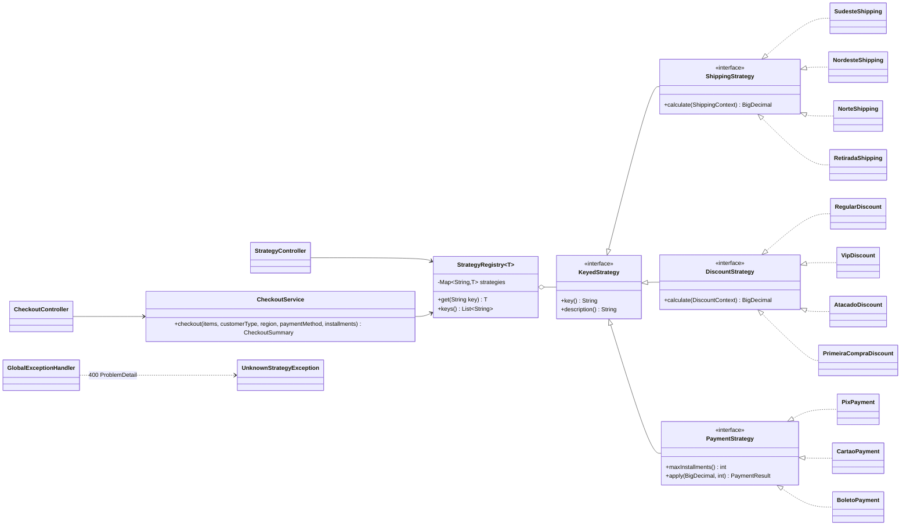
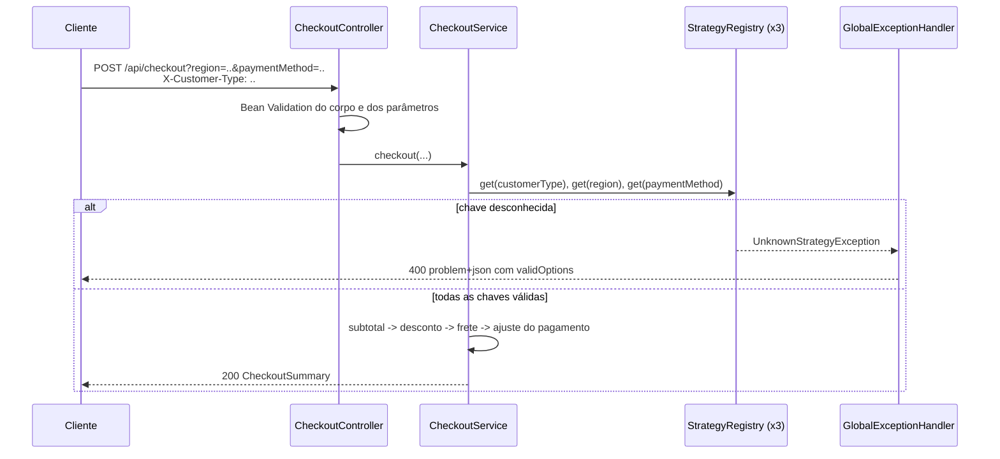

# strategy-pattern-checkout

API REST de checkout em **Java 21 + Spring Boot 3.5** que demonstra o padrão de projeto **Strategy** em três eixos independentes: **frete por região**, **desconto por tipo de cliente** e **forma de pagamento**. Cada regra de negócio é uma classe isolada, registrada como bean do Spring e escolhida em tempo de execução a partir de um parâmetro da requisição ou de um header.

  

## Sumário

- [O que é o padrão Strategy](#o-que-é-o-padrão-strategy)
- [Por que ele importa](#por-que-ele-importa)
- [Arquitetura](#arquitetura)
- [Regras de negócio](#regras-de-negócio)
- [Como executar](#como-executar)
- [Endpoints](#endpoints)
- [Exemplos com curl (respostas reais)](#exemplos-com-curl-respostas-reais)
- [Testes](#testes)
- [Estrutura do projeto](#estrutura-do-projeto)
- [Licença](#licença)

## O que é o padrão Strategy

Strategy é um padrão comportamental do catálogo GoF. Ele define uma **família de algoritmos**, encapsula cada um em sua própria classe e os torna **intercambiáveis** por meio de uma interface comum. Quem usa o algoritmo (o *contexto*) conhece apenas a interface e não sabe qual implementação concreta está executando.

Neste projeto existem três famílias:

| Eixo | Interface | Implementações | Selecionado por |
|---|---|---|---|
| Frete | `ShippingStrategy` | `SUDESTE`, `NORDESTE`, `NORTE`, `RETIRADA` | query param `region` |
| Desconto | `DiscountStrategy` | `REGULAR`, `VIP`, `ATACADO`, `PRIMEIRA_COMPRA` | header `X-Customer-Type` |
| Pagamento | `PaymentStrategy` | `PIX`, `CARTAO`, `BOLETO` | query params `paymentMethod` e `installments` |

## Por que ele importa

Sem Strategy, o cálculo de checkout costuma virar uma cadeia de condicionais:

```java
// Antes: cada nova região, tipo de cliente ou forma de pagamento altera este método
if (region.equals("SUDESTE")) {
    shipping = subtotal >= 299 ? 0 : 15 + 2 * kg;
} else if (region.equals("NORDESTE")) {
    shipping = 25 + 3.5 * kg;
} else if (region.equals("NORTE")) {
    // ...
}
switch (paymentMethod) { /* mais regras misturadas */ }
```

Com Strategy:

```java
// Depois: o serviço não conhece nenhuma regra concreta
ShippingStrategy shipping = shippingRegistry.get(region);
BigDecimal cost = shipping.calculate(new ShippingContext(subtotal, weightKg));
```

Benefícios concretos:

- **Princípio Aberto/Fechado (OCP):** para criar a região `SUL` basta adicionar uma classe `@Component` que implementa `ShippingStrategy`. O `CheckoutService`, o registro e os controllers não mudam.
- **Fim das cadeias de `if/else` e `switch`:** não existe nenhum condicional sobre região, tipo de cliente ou forma de pagamento no `CheckoutService`.
- **Responsabilidade única e testes isolados:** cada regra é testada sozinha, sem subir o Spring.
- **Descoberta automática:** o Spring injeta todas as implementações de cada interface e o `StrategyRegistry` as indexa por chave. Chave duplicada derruba a aplicação na inicialização, não em produção no meio de uma compra.
- **Erro claro para o cliente da API:** chave desconhecida vira HTTP 400 em `application/problem+json` (RFC 9457) com a lista de opções válidas.

## Arquitetura



Fluxo de uma requisição `POST /api/checkout`:



## Regras de negócio

Todos os valores monetários usam `BigDecimal` com **escala 2** e arredondamento **`HALF_EVEN`** (arredondamento bancário), centralizados na classe `Money`.

Ordem do cálculo:

```
subtotal          = soma(unitPrice x quantity)
desconto          = DiscountStrategy(subtotal, quantidade total)
frete             = ShippingStrategy(subtotal - desconto, peso total)
ajuste pagamento  = PaymentStrategy(subtotal - desconto + frete, parcelas)
total             = subtotal - desconto + frete + ajuste pagamento
```

**Desconto** (header `X-Customer-Type`, padrão `REGULAR`)

| Chave | Regra |
|---|---|
| `REGULAR` | Sem desconto |
| `VIP` | 10% sobre o subtotal |
| `ATACADO` | 15% a partir de 10 unidades no carrinho; 5% abaixo disso |
| `PRIMEIRA_COMPRA` | 20% limitado a R$ 50,00 |

**Frete** (query param `region`). O peso cobrado é o peso total arredondado para cima até o quilo inteiro.

| Chave | Regra |
|---|---|
| `SUDESTE` | R$ 15,00 + R$ 2,00/kg; grátis a partir de R$ 299,00 (após desconto) |
| `NORDESTE` | R$ 25,00 + R$ 3,50/kg |
| `NORTE` | R$ 35,00 + R$ 5,00/kg |
| `RETIRADA` | Retirada na loja, sempre grátis |

**Pagamento** (query params `paymentMethod` e `installments`, padrão 1)

| Chave | Regra |
|---|---|
| `PIX` | 5% de desconto, somente 1 parcela |
| `CARTAO` | 1x a 3x sem juros; 4x a 12x com juros compostos de 1,99% a.m. (Tabela Price: `parcela = valor * i / (1 - (1 + i)^-n)`, total = parcela x n) |
| `BOLETO` | Tarifa de emissão de R$ 3,49, somente 1 parcela |

No cartão sem juros o total é exatamente o valor devido e `installments.value` é o valor da parcela arredondado com `HALF_EVEN`. Quando a divisão não é exata, a API não distribui a diferença de centavos entre as parcelas (exemplo: 1.000,00 em 3x mostra parcelas de 333,33 e total 1.000,00).

## Como executar

### Pré-requisitos

- **Gradle:** não precisa instalar. O wrapper (`./gradlew`) baixa o Gradle 8.14.3, e a toolchain Java 21 é resolvida automaticamente pelo plugin `foojay-resolver-convention` mesmo que a máquina tenha apenas um JDK mais antigo (por exemplo, 17) para rodar o Gradle.
- **Docker:** Docker Engine com Compose v2.

### Com Gradle

```bash
./gradlew build        # compila, roda os testes e gera o jar
./gradlew bootRun      # sobe a API em http://localhost:8080
```

No Windows use `gradlew.bat` no lugar de `./gradlew`.

### Com Docker

```bash
docker compose up -d --build          # sobe a API em http://localhost:8089
docker compose logs -f api            # acompanha os logs
docker compose down -v --rmi local    # derruba e remove a imagem local
```

O `Dockerfile` é multi-stage: o estágio de build usa `eclipse-temurin:21-jdk` e o de runtime usa apenas `eclipse-temurin:21-jre`, executando como o usuário sem privilégios `app` (uid 999).

### Documentação interativa

- Swagger UI: `http://localhost:8089/swagger-ui.html` (ou porta 8080 com Gradle)
- OpenAPI JSON: `http://localhost:8089/v3/api-docs`
- Health check: `http://localhost:8089/actuator/health`

## Endpoints

| Método | Caminho | Descrição |
|---|---|---|
| `POST` | `/api/checkout` | Cálculo completo: subtotal, desconto, frete, ajuste do pagamento, total e parcelas |
| `GET` | `/api/strategies` | Todos os eixos, indexados pelo nome do parâmetro que seleciona cada um |
| `GET` | `/api/strategies/shipping` | Estratégias de frete |
| `GET` | `/api/strategies/discounts` | Estratégias de desconto |
| `GET` | `/api/strategies/payments` | Formas de pagamento (com `maxInstallments`) |

As chaves são aceitas sem diferenciar maiúsculas e minúsculas (`cartao` funciona como `CARTAO`).

Respostas de erro (todas HTTP 400, `application/problem+json`):

| `type` | Quando |
|---|---|
| `urn:checkout:problem:unknown-strategy` | Chave de região, tipo de cliente ou pagamento inexistente. Traz `axis`, `invalidValue` e `validOptions` |
| `urn:checkout:problem:validation` | Corpo ou parâmetros inválidos (Bean Validation). Traz `errors[]` com `field` e `message` |
| `urn:checkout:problem:invalid-installments` | Número de parcelas não aceito pela forma de pagamento escolhida |

## Exemplos com curl (respostas reais)

As respostas abaixo foram capturadas do container em execução (`docker compose up -d --build`, porta 8089) e apenas formatadas para leitura.

Carrinho usado nos exemplos:

```bash
CART='{"items":[
  {"sku":"TECLADO-01","name":"Teclado mecanico","unitPrice":199.90,"quantity":1,"weightKg":1.200},
  {"sku":"MOUSE-01","name":"Mouse sem fio","unitPrice":89.90,"quantity":2,"weightKg":0.150}
]}'
```

### 1. Cliente VIP, Sudeste, cartão em 6x

Subtotal 379,70; VIP tira 10% (37,97); 341,73 passa de R$ 299,00, então o frete Sudeste é grátis; 6x a 1,99% a.m. geram parcelas de 60,99.

```bash
curl -s -X POST "http://localhost:8089/api/checkout?region=SUDESTE&paymentMethod=CARTAO&installments=6" \
  -H "Content-Type: application/json" -H "X-Customer-Type: VIP" -d "$CART"
```

```json
{
  "customerType": "VIP",
  "region": "SUDESTE",
  "paymentMethod": "CARTAO",
  "totalQuantity": 3,
  "totalWeightKg": 1.500,
  "subtotal": 379.70,
  "discount": 37.97,
  "shipping": 0.00,
  "paymentAdjustment": 24.21,
  "total": 365.94,
  "installments": {
    "count": 6,
    "value": 60.99
  }
}
```

### 2. Sem header (REGULAR), Nordeste, PIX

1,5 kg vira 2 kg cobrados: 25,00 + 2 x 3,50 = 32,00. O PIX tira 5% de 411,70 = 20,585, que com `HALF_EVEN` vira 20,58.

```bash
curl -s -X POST "http://localhost:8089/api/checkout?region=NORDESTE&paymentMethod=PIX" \
  -H "Content-Type: application/json" -d "$CART"
```

```json
{
  "customerType": "REGULAR",
  "region": "NORDESTE",
  "paymentMethod": "PIX",
  "totalQuantity": 3,
  "totalWeightKg": 1.500,
  "subtotal": 379.70,
  "discount": 0.00,
  "shipping": 32.00,
  "paymentAdjustment": -20.58,
  "total": 391.12,
  "installments": {
    "count": 1,
    "value": 391.12
  }
}
```

### 3. Atacado (12 unidades), Norte, boleto

```bash
curl -s -X POST "http://localhost:8089/api/checkout?region=NORTE&paymentMethod=BOLETO" \
  -H "Content-Type: application/json" -H "X-Customer-Type: ATACADO" \
  -d '{"items":[{"sku":"CABO-USB","name":"Cabo USB-C","unitPrice":49.90,"quantity":12,"weightKg":0.800}]}'
```

```json
{
  "customerType": "ATACADO",
  "region": "NORTE",
  "paymentMethod": "BOLETO",
  "totalQuantity": 12,
  "totalWeightKg": 9.600,
  "subtotal": 598.80,
  "discount": 89.82,
  "shipping": 85.00,
  "paymentAdjustment": 3.49,
  "total": 597.47,
  "installments": {
    "count": 1,
    "value": 597.47
  }
}
```

### 4. Primeira compra, retirada na loja, cartão em 3x sem juros

```bash
curl -s -X POST "http://localhost:8089/api/checkout?region=RETIRADA&paymentMethod=CARTAO&installments=3" \
  -H "Content-Type: application/json" -H "X-Customer-Type: PRIMEIRA_COMPRA" -d "$CART"
```

```json
{
  "customerType": "PRIMEIRA_COMPRA",
  "region": "RETIRADA",
  "paymentMethod": "CARTAO",
  "totalQuantity": 3,
  "totalWeightKg": 1.500,
  "subtotal": 379.70,
  "discount": 50.00,
  "shipping": 0.00,
  "paymentAdjustment": 0.00,
  "total": 329.70,
  "installments": {
    "count": 3,
    "value": 109.90
  }
}
```

### 5. Região inexistente: HTTP 400

```bash
curl -s -X POST "http://localhost:8089/api/checkout?region=SUL&paymentMethod=PIX" \
  -H "Content-Type: application/json" -d "$CART"
```

```json
{
  "type": "urn:checkout:problem:unknown-strategy",
  "title": "Unknown strategy",
  "status": 400,
  "detail": "Unknown strategy 'SUL' for region. Valid options: [NORDESTE, NORTE, RETIRADA, SUDESTE]",
  "instance": "/api/checkout",
  "axis": "region",
  "invalidValue": "SUL",
  "validOptions": ["NORDESTE", "NORTE", "RETIRADA", "SUDESTE"]
}
```

### 6. Tipo de cliente inexistente no header: HTTP 400

```bash
curl -s -X POST "http://localhost:8089/api/checkout?region=SUDESTE&paymentMethod=PIX" \
  -H "Content-Type: application/json" -H "X-Customer-Type: GOLD" -d "$CART"
```

```json
{
  "type": "urn:checkout:problem:unknown-strategy",
  "title": "Unknown strategy",
  "status": 400,
  "detail": "Unknown strategy 'GOLD' for customerType. Valid options: [ATACADO, PRIMEIRA_COMPRA, REGULAR, VIP]",
  "instance": "/api/checkout",
  "axis": "customerType",
  "invalidValue": "GOLD",
  "validOptions": ["ATACADO", "PRIMEIRA_COMPRA", "REGULAR", "VIP"]
}
```

### 7. Forma de pagamento inexistente: HTTP 400

```bash
curl -s -X POST "http://localhost:8089/api/checkout?region=SUDESTE&paymentMethod=CHEQUE" \
  -H "Content-Type: application/json" -d "$CART"
```

```json
{
  "type": "urn:checkout:problem:unknown-strategy",
  "title": "Unknown strategy",
  "status": 400,
  "detail": "Unknown strategy 'CHEQUE' for paymentMethod. Valid options: [BOLETO, CARTAO, PIX]",
  "instance": "/api/checkout",
  "axis": "paymentMethod",
  "invalidValue": "CHEQUE",
  "validOptions": ["BOLETO", "CARTAO", "PIX"]
}
```

### 8. Corpo inválido: HTTP 400

```bash
curl -s -X POST "http://localhost:8089/api/checkout?region=SUDESTE&paymentMethod=PIX" \
  -H "Content-Type: application/json" \
  -d '{"items":[{"sku":"","name":"Produto","unitPrice":-1,"quantity":0,"weightKg":1.0}]}'
```

```json
{
  "type": "urn:checkout:problem:validation",
  "title": "Validation failed",
  "status": 400,
  "detail": "Request has 3 invalid field(s)",
  "instance": "/api/checkout",
  "errors": [
    {
      "field": "items[0].quantity",
      "message": "must be greater than or equal to 1"
    },
    {
      "field": "items[0].sku",
      "message": "must not be blank"
    },
    {
      "field": "items[0].unitPrice",
      "message": "must be greater than or equal to 0.01"
    }
  ]
}
```

### 9. Parcelas fora do limite: HTTP 400

```bash
curl -s -X POST "http://localhost:8089/api/checkout?region=SUDESTE&paymentMethod=CARTAO&installments=13" \
  -H "Content-Type: application/json" -d "$CART"
```

```json
{
  "type": "urn:checkout:problem:validation",
  "title": "Validation failed",
  "status": 400,
  "detail": "Request has 1 invalid field(s)",
  "instance": "/api/checkout",
  "errors": [
    {
      "field": "installments",
      "message": "must be less than or equal to 12"
    }
  ]
}
```

### 10. PIX parcelado: HTTP 400

```bash
curl -s -X POST "http://localhost:8089/api/checkout?region=SUDESTE&paymentMethod=PIX&installments=2" \
  -H "Content-Type: application/json" -d "$CART"
```

```json
{
  "type": "urn:checkout:problem:invalid-installments",
  "title": "Invalid installments",
  "status": 400,
  "detail": "Payment method PIX accepts 1 to 1 installment(s), got 2",
  "instance": "/api/checkout",
  "paymentMethod": "PIX",
  "maxInstallments": 1
}
```

### 11. Listagem de estratégias

```bash
curl -s http://localhost:8089/api/strategies
```

```json
{
  "customerType": [
    {
      "key": "ATACADO",
      "description": "Wholesale: 15% off from 10 units, 5% below that"
    },
    {
      "key": "PRIMEIRA_COMPRA",
      "description": "First purchase: 20% off, limited to R$ 50,00"
    },
    {
      "key": "REGULAR",
      "description": "No discount"
    },
    {
      "key": "VIP",
      "description": "10% off the subtotal"
    }
  ],
  "region": [
    {
      "key": "NORDESTE",
      "description": "R$ 25,00 + R$ 3,50/kg"
    },
    {
      "key": "NORTE",
      "description": "R$ 35,00 + R$ 5,00/kg"
    },
    {
      "key": "RETIRADA",
      "description": "Store pickup, always free"
    },
    {
      "key": "SUDESTE",
      "description": "R$ 15,00 + R$ 2,00/kg; free shipping for orders from R$ 299,00"
    }
  ],
  "paymentMethod": [
    {
      "key": "BOLETO",
      "description": "Bank slip with a R$ 3,49 issuance fee, single installment",
      "maxInstallments": 1
    },
    {
      "key": "CARTAO",
      "description": "Credit card: up to 3x interest free, 4x to 12x with 1.99% monthly interest (Price table)",
      "maxInstallments": 12
    },
    {
      "key": "PIX",
      "description": "Instant payment with 5% off, single installment",
      "maxInstallments": 1
    }
  ]
}
```

```bash
curl -s http://localhost:8089/api/strategies/shipping
```

```json
[
  {
    "key": "NORDESTE",
    "description": "R$ 25,00 + R$ 3,50/kg"
  },
  {
    "key": "NORTE",
    "description": "R$ 35,00 + R$ 5,00/kg"
  },
  {
    "key": "RETIRADA",
    "description": "Store pickup, always free"
  },
  {
    "key": "SUDESTE",
    "description": "R$ 15,00 + R$ 2,00/kg; free shipping for orders from R$ 299,00"
  }
]
```

```bash
curl -s http://localhost:8089/api/strategies/discounts
```

```json
[
  {
    "key": "ATACADO",
    "description": "Wholesale: 15% off from 10 units, 5% below that"
  },
  {
    "key": "PRIMEIRA_COMPRA",
    "description": "First purchase: 20% off, limited to R$ 50,00"
  },
  {
    "key": "REGULAR",
    "description": "No discount"
  },
  {
    "key": "VIP",
    "description": "10% off the subtotal"
  }
]
```

```bash
curl -s http://localhost:8089/api/strategies/payments
```

```json
[
  {
    "key": "BOLETO",
    "description": "Bank slip with a R$ 3,49 issuance fee, single installment",
    "maxInstallments": 1
  },
  {
    "key": "CARTAO",
    "description": "Credit card: up to 3x interest free, 4x to 12x with 1.99% monthly interest (Price table)",
    "maxInstallments": 12
  },
  {
    "key": "PIX",
    "description": "Instant payment with 5% off, single installment",
    "maxInstallments": 1
  }
]
```

## Testes

```bash
./gradlew test
```

- **Unitários (sem Spring):** cada estratégia de frete, desconto e pagamento; o `StrategyRegistry` (seleção por chave, chave em minúsculas ou com espaços, chave desconhecida, nula ou vazia, chave duplicada, registro vazio); a classe `Money`; e o `CheckoutService` combinando os três eixos.
- **Integração (MockMvc + `@SpringBootTest`):** caminhos felizes nos quatro tipos de cliente, regiões e formas de pagamento; 400 para estratégia desconhecida em cada eixo; 400 para corpo inválido, carrinho vazio, JSON malformado, parâmetro obrigatório ausente, parcelas acima de 12 e PIX parcelado; listagem de estratégias e documento OpenAPI.

Os valores esperados da Tabela Price nos testes foram calculados de forma independente (Python `decimal`, `ROUND_HALF_EVEN`) e não copiados da saída da própria aplicação.

## Estrutura do projeto

```
src/main/java/io/github/joaopedro/checkout
├── CheckoutApplication.java
├── api/                 # controllers, DTOs (records) e GlobalExceptionHandler
├── checkout/            # CheckoutService e CheckoutSummary
├── config/              # registries por eixo e metadados OpenAPI
├── discount/            # DiscountStrategy + REGULAR, VIP, ATACADO, PRIMEIRA_COMPRA
├── money/               # escala e arredondamento monetário
├── payment/             # PaymentStrategy + PIX, CARTAO, BOLETO
├── shipping/            # ShippingStrategy + SUDESTE, NORDESTE, NORTE, RETIRADA
└── strategy/            # KeyedStrategy, StrategyRegistry, UnknownStrategyException
```

### Como adicionar uma nova estratégia

1. Crie a classe, por exemplo `SulShipping implements ShippingStrategy`, anotada com `@Component`.
2. Retorne a chave `"SUL"` em `key()` e implemente `calculate(...)`.
3. Escreva o teste unitário da regra.

Nada mais muda: o `StrategyRegistry` a descobre na inicialização, `GET /api/strategies/shipping` passa a listá-la e a mensagem de erro de região inválida já inclui `SUL` nas opções válidas.

## Licença

Distribuído sob a licença MIT. Veja [LICENSE](LICENSE).

Autor: **Joao Pedro Teixeira Rocha**
